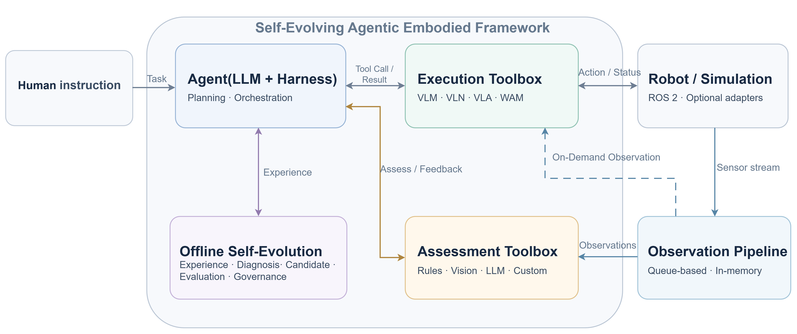

# Self-Evolving Agentic Embodied Framework

**v1.1.0rc3 · Python 3.12 · Single Agent · LLM-Centric · Governed Offline Self-Evolution**

自进化智能体具身智能框架，将任务规划、执行工具、结果评估、实时观测与离线自进化组织为可扩展的闭环。模型、机器人和仿真器通过可选 Provider / Adapter / Plugin 接入，核心框架不绑定具体实验平台。

**English summary:** A single-agent, LLM-centric embodied framework with independent execution and assessment toolboxes, a push-based observation pipeline, an evidence-gated execution harness, and governed offline self-evolution.

## 框架概览



人类自然语言指令进入唯一 Agent，由 LLM 完成理解、规划、工具选择和重规划。Harness 管理执行授权与审计；执行工具提供能力，评估工具独立解释任务结果。环境传感器持续将新数据推入 Observation Pipeline，两套工具箱按需读取观测，并将结构化结果反馈给 Agent。

图中的 **On-Demand Observation** 表示工具按需读取已经进入 Queue 的观测；传感器入口始终是实时 Push。VLM、VLN、VLA、WAM、控制器和机器人/仿真器表示可接入的能力与适配边界，当前仓库提供通用接口和合成示例。

## 核心组成

| 模块 | 职责 |
| --- | --- |
| **Single Agent / LLM Brain** | 理解自然语言、分解任务、选择工具、结合反馈决策与重规划 |
| **Execution Toolbox** | 注册 VLM / VLN / VLA / WAM、传统规划器、控制器和自定义工具的能力契约 |
| **Assessment Toolbox** | 独立管理可插拔评估器，返回 `SUPPORTED`、`NOT_SUPPORTED` 或 `UNKNOWN` |
| **Observation Pipeline** | 实时 Push、每传感器独立有界内存 Queue、非破坏性多读者访问 |
| **Agentic Harness** | 工具授权、持久化执行意图、事件审计、Worker Lease / Fencing、不确定状态恢复 |
| **Memory / Experience / Offline Self-Evolution** | 结构化经验、故障诊断、改进候选、离线评估、人工治理、版本化策略发布与回滚 |
| **Application / Plugins / Adapters** | 统一装配、依赖注入、插件版本检查、生命周期管理及可选环境接入 |

`FrameworkBuilder` 将这些组件组装为一个 `SingleAgentFramework`，复用同一个执行 Registry、Observation Pipeline 和工作流引擎。

## 快速开始

要求 **Python `>=3.12,<3.13`**。核心运行依赖 Python 标准库；`dev` 提供 pytest，`llm` 提供可选 OpenAI-compatible Provider SDK。

在仓库根目录执行以下 Windows CMD 命令：

```cmd
conda env create -f environment.yml
conda activate embodied-research
python -m pip install -e "framework[dev]"
```

已有 `embodied-research` 环境时，跳过第一条命令。使用其他 Python 3.12 环境也可以直接执行 editable 安装命令。

### 运行最小框架示例

```cmd
python framework\examples\framework_minimal.py
```

该示例使用本地 Stub LLM、合成传感器数据和只读工具，完整演示：

```text
FrameworkBuilder → start → publish_observation
    → LLM plan → authorized workflow → read-only tool
    → independent assessment → Agent decision → close
```

无需 API Key、ROS 2、机器人或仿真器。报告中的 `EXECUTION_WORKFLOW_COMPLETED` 表示声明的工作流步骤完成，`SUPPORTED` 表示评估器支持相应目标判断。

### 更多示例

| 示例 | 内容 | 命令 |
| --- | --- | --- |
| [最小框架初始化](framework/examples/framework_minimal.py) | 唯一 Brain、工具注册、评估反馈与生命周期 | `python framework\examples\framework_minimal.py` |
| [插件注册与配置](framework/examples/plugin_registration.py) | 可信 Catalog、精确版本选择、TOML 装配与任务运行 | `python framework\examples\plugin_registration.py` |
| [Observation Pipeline](framework/examples/observation_pipeline.py) | Push、latest / window / snapshot / subscribe 与独立 Queue | `python framework\examples\observation_pipeline.py` |
| [双工具箱集成](framework/examples/dual_toolbox_integration.py) | 执行能力与独立结果评估的接口组合 | `python framework\examples\dual_toolbox_integration.py` |
| [ROS 2 接入模板](framework/examples/ros2_optional_integration.py) | Topic 入口、宿主 Executor 与动作授权边界 | 配置参考；由 ROS 宿主提供节点与 Executor |

## 执行与评估闭环

```text
Human instruction → LLM plan → validated task plan
    → Harness-authorized tool invocation → observations / tool report
    → independent assessment → LLM decision
    → CONTINUE / REPLAN / WAIT_FOR_OBSERVATION / STOP
```

执行工具的模型输出、调用完成、物理执行状态和任务目标达成分别处理。Assessment Toolbox 的结果是基于可用信息的推断，环境无需提供天然的任务成功标签。

观测缺失或结果不确定时，Agent 可以等待新观测。已知的只读执行失败可进入受限重规划；已派发且结果未知的副作用调用进入审阅或资源隔离，不自动重复执行。任务恢复核对持久化状态及固定的工具、评估路由和策略版本。

## Observation Pipeline

- **实时 Push**：源适配器收到新数据立即调用 `ObservationSink.push(...)`。
- **独立有界 Queue**：每个传感器/模态分别配置频率、保留时间与容量；默认保留最近 **60 秒**。
- **容量控制**：默认容量为 `ceil(frequency_hz × retention_seconds)`，可用每流 `capacity` 独立覆盖；全局内存预算可提前淘汰记录。
- **时间与序列**：每条观测包含单调接收时间、序列标识及可选源时间戳/时钟域；多源 snapshot 报告对齐质量。
- **只读接口**：工具通过限定传感器键和新鲜度的 `ObservationReader` 使用 `latest`、`window`、`snapshot`、`subscribe`，多个读者互不消费共享数据。

原始图像、点云、IMU 和关节状态等传感器流保留在内存 Queue，框架不将这些原始流写入 SQLite。数据库保存任务、事件链、紧凑结果/评估摘要及治理记录；工具插件应返回结构化摘要。

ROS 2 继续负责通信、节点和底层传感器机制，框架只提供对应适配入口。

## 离线自进化与治理

```text
Experience → Failure Diagnosis → Evolution Candidate
    → Offline Evaluation → Human Review / Governance
    → Versioned Policy Release / Rollback
    → Explicit runtime activation for future tasks
```

候选是待评估的改进提案。离线评估与人工治理独立于在线执行，审批发布不会自动赋予设备控制权限。当前显式策略激活限定在受控只读运行范围，通过既有接口影响未来任务的规划、工具选择、观测获取或评估路由。

进行中任务保持原策略版本；发布/回滚不改写已有任务的固定记录，也不撤销物理世界中的动作。

## 扩展接口与生命周期

| 扩展点 | 宿主提供的实现 |
| --- | --- |
| LLM Provider | `complete(system_prompt, user_prompt)`，经 `FrameworkBuilder(..., provider=provider)` 注入 |
| 只读执行工具 | `factory(reader)` 返回实现 `invoke(arguments)` 的 Handler |
| 结果评估器 | `assess(request, reader)` 返回 `AssessmentResult` |
| 观测源 | `factory(sink)` 返回支持 `start()` / `close()` 的数据源 |
| 有副作用 Adapter | 通过宿主 `ExecutionGrant` 和现有授权桥接入，提供 fencing、独立 observe、invoke 与 stop 接口 |

可信宿主注册插件工厂，TOML 仅选择允许的 ID、种类和精确版本，不加载任意 Python 路径或授予动作权限。配置模板见 [framework_plugins.example.toml](framework/configs/framework_plugins.example.toml) 与 [observation_pipeline.toml](framework/configs/observation_pipeline.toml)。

框架支持 `with framework:` 管理启动与关闭，观测源和显式托管资源逆序释放。外部 SDK 的长期资源由宿主明确管理；网络超时和设备侧停止机制由相应 Provider / Adapter 实现。Python 调用超时限制等待时间，无法强制终止底层线程或物理动作。

需要可选在线 LLM SDK 时，在仓库根目录安装：

```cmd
python -m pip install -e "framework[llm]"
```

## 测试与当前版本

在仓库根目录运行：

```cmd
python -m pytest framework\tests -q
```

**2026-10-13 本地验收：Windows / Python 3.12.14，70 项测试全部通过。** 覆盖框架装配、工具箱集成、观测 Queue、决策与恢复、数据库迁移、Worker Lease、事件链、超时、资源释放和离线策略治理。

测试使用 Stub Provider、合成数据与本地 Fake/只读工具。当前版本保持 **v1.1.0rc3**；真实 LLM 服务、ROS 2 节点、机器人、特定仿真器和具体 VLA/VLN/WAM 模型尚未联调，合成验收不证明真实任务效果或自进化性能收益。

工具注册不代表物理执行授权，LLM 不能自行授予权限；执行结果未知时不盲目重试，ROS Action 的取消请求不等于设备已安全停止。正式版发布及外部 Adapter 接入分别验收。

## 仓库结构

```text
self-evolution_agentic_embodied/
├── README.md
├── environment.yml
├── image/
│   └── self_evolving_framework_overview.png
└── framework/
    ├── README.md
    ├── pyproject.toml
    ├── MANIFEST.in
    ├── configs/
    ├── examples/
    ├── tests/
    └── src/self_evolving_embodied/
        ├── application/       # 统一装配与生命周期
        ├── agent/             # 唯一 Brain 与执行循环
        ├── planning/          # LLM 规划与计划校验
        ├── toolboxes/         # 执行 / 评估工具箱
        ├── tools/             # 工具契约与 Registry
        ├── observations/      # 实时内存 Queue
        ├── harness/           # 授权、证据与恢复
        ├── runtime/           # 持久化工作流
        ├── storage/           # SQLite
        ├── memory/            # 记忆
        ├── experience/        # 经验
        ├── diagnosis/         # 故障诊断
        ├── evolution/         # 离线改进候选
        ├── evaluation/        # 离线评估
        ├── review/            # 人工审查接口
        ├── governance/        # 策略版本、发布与回滚
        ├── plugins/           # 可信插件与配置
        ├── adapters/          # 可选 Provider / Fake Adapter
        ├── integrations/      # Environment / ROS 2 接口
        └── core/              # 共享数据契约与标识
```

`python -m self_evolving_embodied` 保留为历史 Fake-only CLI；通用框架应用入口是 `FrameworkBuilder` / `SingleAgentFramework`。示例与源码接口不依赖具体机器人实验、数据集或 Benchmark。
